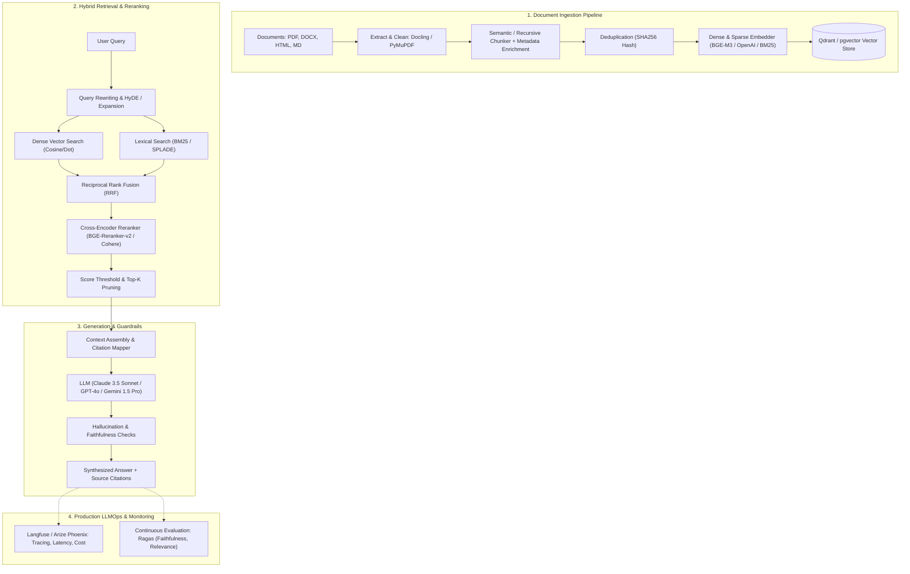

# Production RAG (Retrieval-Augmented Generation) Pipeline

An enterprise-ready, modular, and observable RAG architecture designed for high precision, low latency, and production reliability.

---

## 1. High-Level Architecture



---

## 2. Directory Layout

```
production-rag-pipeline/
├── .env.example                     # Environment variables & API keys
├── pyproject.toml                   # uv / Python project dependencies
├── README.md                        # Project documentation & execution guide
├── docker/
│   ├── Dockerfile                   # Production API container
│   └── docker-compose.yml           # Qdrant, Redis, Langfuse stack
├── src/
│   ├── api/                         # FastAPI presentation layer
│   │   ├── main.py                  # API entry point & lifecycle
│   │   ├── dependencies.py          # Service injection & authentication
│   │   └── v1/                      # Versioned route handlers (query, ingest)
│   ├── core/                        # Application configuration & logging
│   │   ├── config.py                # Pydantic Settings
│   │   └── logger.py                # Structured JSON logging
│   ├── ingestion/                   # Document parsing & chunking pipeline
│   │   ├── parsers/                 # Extract text/tables from PDF, DOCX, etc.
│   │   ├── chunkers/                # Semantic & hierarchical chunking
│   │   └── pipeline.py              # Ingestion orchestrator & deduplication
│   ├── embeddings/                  # Dense & sparse vector generators
│   │   ├── base.py                  # Abstract embedding interface
│   │   └── providers.py             # OpenAI, FastEmbed, HuggingFace
│   ├── storage/                     # Vector database & metadata stores
│   │   ├── base.py                  # Vector store abstract base class
│   │   └── qdrant.py                # Qdrant client implementation
│   ├── retrieval/                   # Search, fusion, and reranking
│   │   ├── hybrid.py                # Dense + BM25 Reciprocal Rank Fusion
│   │   ├── query_transform.py       # HyDE, multi-query, rewriting
│   │   └── rerankers.py             # Cross-encoder reranking
│   ├── generation/                  # Prompting, LLM clients, citations
│   │   ├── llm_client.py            # LiteLLM / LangChain streaming client
│   │   ├── prompts.py               # Grounded prompt templates
│   │   └── guardrails.py            # Hallucination filter & citation grounder
│   └── evaluation/                  # Continuous assessment & benchmarking
│       ├── metrics.py               # Ragas metrics (Faithfulness, Recall, etc.)
│       └── eval_runner.py           # Synthetic golden dataset test runner
├── tests/
│   ├── unit/                        # Unit tests for chunkers, rerankers, etc.
│   ├── integration/                 # Integration tests with Vector DB & API
│   └── evaluation/                  # Offline quality benchmark tests
└── data/
    ├── raw/                         # Raw documents
    └── processed/                   # Chunks and intermediate data
```

---

## 3. Core Production Pillars

### A. Advanced Parsing & Ingestion
- **Document Structure Preservation**: Standard splitting loses table relationships and headers. Use tools like `Docling` or `PyMuPDF` with markdown output to preserve headings and tables.
- **Hierarchical / Parent-Document Chunking**: Ingest small chunks (256-512 tokens) for precise embedding lookup, but link them back to larger parent chunks (1024-2048 tokens) fed to the LLM for richer contextual synthesis.
- **Idempotency & Deduplication**: Compute document & chunk hashes (`sha256(content + metadata)`). Prevent duplicate vector embeddings upon re-ingestion.

### B. Hybrid Search & Cross-Encoder Reranking
- **Dense Vector Search**: Captures conceptual semantics (`text-embedding-3-small`, `BAAI/bge-m3`).
- **Sparse BM25 Search**: Captures exact terminology, part numbers, acronyms, and codes.
- **Reciprocal Rank Fusion (RRF)**:
  $$\text{RRF Score}(d) = \sum_{m \in M} \frac{1}{60 + r_m(d)}$$
- **Reranker (Crucial Step)**: Top 30-50 retrieved candidates are re-scored using a cross-encoder (`bge-reranker-v2-m3` or `Cohere Rerank v3`). Cross-encoders perform full cross-attention between query and candidate text, dramatically cutting down irrelevant retrieval noise before LLM prompting.

### C. Contextual Synthesis & Hallucination Guardrails
- **Strict Grounding**: System prompts strictly require the model to cite numbered reference brackets `[1]`, `[2]`.
- **Fall-back Policy**: If similarity scores fall below the minimum threshold, the system immediately returns an explicit *"I do not have sufficient information in the provided context"* rather than hallucinating.
- **Output Validation**: Pydantic structured output with field-level citations and confidence scores.

### D. Observability & Evaluation (LLMOps)
- **Tracing**: Langfuse integration to capture every span (query rewrite time, vector DB latency, reranker latency, time-to-first-token).
- **Automated Metric Suite (Ragas)**:
  1. *Faithfulness*: Are all claims made in the answer grounded in the retrieved chunks?
  2. *Answer Relevance*: Does the answer directly address the user query?
  3. *Context Precision*: Are retrieved chunks at the top relevant?
  4. *Context Recall*: Were all necessary chunks retrieved?

---

## 4. Quickstart Guide

### 1. Environment Setup
```bash
# Navigate to project directory
cd D:\production-rag-pipeline

# Create virtual environment with uv
uv venv
.venv\Scripts\activate

# Install dependencies
uv pip install -e .
```

### 2. Infrastructure Startup
```bash
# Start Qdrant vector database and Redis cache
docker compose -f docker/docker-compose.yml up -d
```

### 3. Run API Server
```bash
uvicorn src.api.main:app --reload --host 0.0.0.0 --port 8000
```
API Documentation will be live at `http://localhost:8000/docs`.
