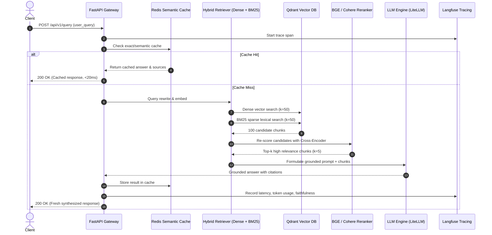

# Enterprise Production RAG Blueprint & Implementation Plan

This blueprint outlines the architectural decisions, trade-offs, and phased execution plan for deploying a high-reliability, low-latency enterprise Retrieval-Augmented Generation (RAG) system.

---

## 1. Production Architecture Overview

A production RAG system differs from a naive RAG tutorial across 5 major dimensions:
1. **Hybrid Retrieval**: Combines dense semantic vectors with lexical BM25/SPLADE keywords to handle exact acronyms and jargon.
2. **Cross-Encoder Reranking**: Eliminates noise from the top 30-50 candidates to send only high-signal chunks to the LLM.
3. **Structured Context & Citation Grounding**: Forces the LLM to output verifiable citations and back-links.
4. **Resilience & Caching**: Semantic caching via Redis prevents repetitive LLM and embedding calls, cutting costs by 40-70%.
5. **Observability & Continuous Evaluation**: Tracing spans with Langfuse and running continuous RAGAS evaluation on production queries.

---

## 2. Ingestion Pipeline Strategy

### 2.1 Multi-Modal Parsing
- For PDFs with tables and formulas: use **Docling** or **PyMuPDF4LLM** to output clean Markdown tables instead of flattened unreadable text.
- Metadata extraction: preserve `document_id`, `page_number`, `header_path` (e.g. `Doc > Section 2 > Sub 3`), and `created_timestamp`.

### 2.2 Hierarchical Chunking (Parent-Child Strategy)
- **Problem with fixed-size chunks**: Small chunks (200 tokens) have good embedding specificity but poor LLM context. Large chunks (1000 tokens) dilute embedding focus.
- **Solution**:
  - Ingest **Child Chunks** (~300 tokens) for dense vector index search.
  - Link each Child Chunk to a **Parent Chunk** (~1200 tokens).
  - During retrieval, find matches on Child Chunks, but pass the Parent Chunk context into the LLM context window.

### 2.3 Deduplication & Hash Indexing
- Compute `sha256(chunk_text + chunk_metadata)`.
- If hash exists in the metadata store, skip re-embedding to save API costs and prevent duplicate hits.

---

## 3. Retrieval & Reranking Stack

| Layer | Technology Choice | Why It's Chosen |
|---|---|---|
| **Vector DB** | **Qdrant** | Written in Rust; native hybrid search (dense + sparse payload), ultra-fast filtered search, HNSW indexing. |
| **Dense Embeddings** | `text-embedding-3-small` / `bge-m3` | 1536 dims, cost-effective, high MTEB benchmark performance. |
| **Sparse Retrieval** | BM25 / SPLADE | Handles part numbers, error codes, and niche domain jargon where dense embeddings fail. |
| **Reranker** | `BAAI/bge-reranker-v2-m3` or `Cohere Rerank v3` | Cross-encoder architecture computes bidirectional token attention between query and chunk. |
| **Fusion** | Reciprocal Rank Fusion (RRF) | Balances different score distributions without needing manual calibration. |

---

## 4. Phase-by-Phase Implementation Roadmap

### Phase 1: Foundation & Infrastructure (Days 1–2)
- [x] Create project layout and configuration schemas (`src/core/config.py`).
- [x] Configure Docker environment (`docker-compose.yml` with Qdrant and Redis).
- [ ] Initialize Python virtual environment with `uv` and install core dependencies.
- [ ] Implement Qdrant connection manager and collection creation scripts.

### Phase 2: Ingestion & Document Processing (Days 3–4)
- [ ] Implement Markdown/PDF extractors using PyMuPDF / Docling.
- [ ] Build hierarchical chunker (parent-child relationship).
- [ ] Implement SHA256 document hasher & idempotency store.
- [ ] Build batch ingestion script with progress tracking.

### Phase 3: Hybrid Retrieval & Reranking (Days 5–6)
- [ ] Implement dense embedding generation via OpenAI / FastEmbed.
- [ ] Implement sparse BM25 indexing in Qdrant.
- [ ] Write Reciprocal Rank Fusion (RRF) logic.
- [ ] Integrate local cross-encoder (`sentence-transformers/bge-reranker-v2-m3`) with fallback to Cohere API.

### Phase 4: Generation, Guardrails & Citations (Days 7–8)
- [ ] Design robust citation prompt templates enforcing strict markdown references `[1]`, `[2]`.
- [ ] Implement streaming LLM client with LiteLLM (supporting OpenAI, Anthropic, Gemini, or local vLLM).
- [ ] Add confidence scoring: return "Information not found" if reranker top score is below threshold (e.g., < 0.40).
- [ ] Implement FastAPI endpoints for `/api/v1/query` and `/api/v1/ingest`.

### Phase 5: Evaluation & LLMOps (Days 9–10)
- [ ] Instrument Langfuse tracing for end-to-end request lifecycle and token costs.
- [ ] Build synthetic golden question-answer test dataset (50 curated QA pairs).
- [ ] Configure automated Ragas CI/CD pipeline checking **Faithfulness** and **Context Recall**.
- [ ] Performance benching: target p95 latency under 1.8 seconds.
